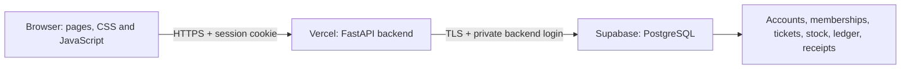

# Hosting ClubLedger: Supabase + Vercel

Live demo: **https://clubledger-gold.vercel.app**

## Where each part runs

The four source folders remain unchanged: `frontend/` owns the design, `backend/` owns API routes and business rules, `database/` owns SQL migrations, and `config/` explains environment settings. Vercel hosts the existing application, rather than a separate replacement frontend.

| File or folder | Job |
| --- | --- |
| `backend/server.py` | Vercel entry point; exports the existing FastAPI application |
| `backend/clubledger/core/postgres.py` | PostgreSQL connection, parameterized SQL adapter, migration checks and transaction protection |
| `backend/clubledger/security/ratelimit.py` | Shared database rate limits on cloud; in-memory limits locally |
| `database/postgres/0001`–`0010` | PostgreSQL equivalents of the original SQLite migrations, including financial triggers |
| `database/postgres/0011_cloud.sql` | Persistent receipt contents and shared rate-limit attempts |
| `vercel.json` | FastAPI framework and Mumbai function region, close to the Supabase database |
| `.python-version` | Python 3.12 for deployment |
| `.vercelignore` | Excludes local databases, virtual environments, secrets and tests from uploads |
| `tests/cloud/` | Existing acceptance flows repeated against isolated PostgreSQL test schemas |

## Database and security

The cloud project is **ClubLedger**, in Mumbai. Application data lives in the dedicated `clubledger` schema. The app uses Supabase's transaction pooler on port 6543, requires TLS, and disables prepared statements for pooler compatibility.

The dedicated `clubledger_app` backend login can read and write ClubLedger records, use its sequences and execute its guard functions. It cannot create or alter the schema. Tables have row-level security policies restricted to this backend role. Supabase browser roles have no table grants. Browser requests go through the existing login, permission and CSRF checks; browsers never receive a database password.

Booking and ledger writes hold a transaction-scoped advisory lock, preserving the original single-writer accounting and inventory rules. Rate limits use separate per-bucket locks so a check inside a booking request does not deadlock with its enclosing transaction. Posted journal entries and closed snapshots remain protected by database triggers.

SQLite still works for local development and the original local database is preserved. PostgreSQL is selected only when `CLUBLEDGER_DATABASE_URL` is set. Cloud setup seeds synthetic demo data; it does not copy private local records.

## Server-only environment variables

| Variable | Vercel value |
| --- | --- |
| `CLUBLEDGER_DATABASE_URL` | Private TLS pooler connection URL for the dedicated backend role |
| `CLUBLEDGER_SIM_SECRET` | Stable private secret that signs simulated payment outcomes |
| `CLUBLEDGER_ENV` | `prod`, enabling production cookies and disabling development-only routes |

The first two are stored as sensitive variables in Vercel production and preview environments. They are not in GitHub, HTML, JavaScript or `.env.example`. Administrative migration credentials are separate from the runtime login and are not uploaded to Vercel.

## Files and maintenance

Cloud receipt bytes are stored transactionally in PostgreSQL alongside their metadata. Authorized downloads work after a Vercel cold start because uploads do not depend on temporary server files. Cloud receipts are limited to **3 MB**; local receipts retain the original **5 MB** limit. PNG, JPEG and PDF validation and ownership checks still apply.

Payments remain a **simulator**, including success/failure buttons and signed callbacks. Email supports real Brevo SMTP delivery through the durable outbox. Local tests use capture or disabled delivery. Hosting does not enable a real payment provider. See EMAIL_DELIVERY.md for sender configuration and delivery status.

Use existing officer controls and CLI commands for settlement, reservation cleanup, mail processing and semester close. Scheduled mail processing uses Vercel and GitHub Actions; see EMAIL_DELIVERY.md. Never run schema migrations on every web request. Apply new numbered PostgreSQL migrations through an administrative connection, then grant the runtime role access to any new tables and enable the corresponding backend-only RLS policy.

## Verification

Run the normal suite with `python -m pytest -q`. Cloud tests skip unless `CLUBLEDGER_CLOUD_TEST_URL` is supplied securely. With a dedicated administrative test connection, run `python -m pytest tests/cloud -q`. Each test creates a random schema, migrates it, exercises real application flows and removes only that test schema afterward.

The runtime login has no permission to create test schemas. Do not use the production application schema for these tests. Validate the deployed `/health`, login, static assets and protected pages after each release. Test results describe observed behavior, not an evaluator score or a guarantee of perfection.

### Release verification: 11 October 2026

- Local suite: **227 passed, 14 cloud-only skipped**, one existing Starlette/HTTPx deprecation warning.
- Real Supabase acceptance cases: **14 passed across two runs** (first eight flows, then six remaining flows after the aggregate-query correction).
- Ruff: passed.
- Public HTTPS health, login and stylesheet: 200.
- Restricted runtime role: demo login, simulated ticket payment and persistent issued ticket verified; student and administrator pages returned 200.
- Database role checks: no schema CREATE privilege, zero application tables without RLS, zero browser-role table grants.
- Existing local SQLite data was not migrated or reset.

## Hosted demo login

This demo sets `CLUBLEDGER_DEMO_ACCOUNTS=1` so reviewers can see the synthetic demo-account emails and password on the login page while `CLUBLEDGER_ENV=prod` remains enabled. All club content, including event listings, the store and announcements, requires login. Signed-out HTML requests redirect to `/auth/login`; JSON requests receive 401. Login, registration, static assets, health checks, signed payment callbacks and subscription opt-out links retain their dedicated public boundaries.

Login-boundary correction: 245 local tests passed; the new real Supabase boundary test passed. Signed-out browser redirects, JSON 401 responses, demo hints and production-only restrictions have dedicated regression tests.

## Failed purchase attempts

A verified payment failure releases an unpaid merchandise reservation and ticket hold, and cancels a pending membership application in the same transaction. Payment records remain for history; no journal income or membership benefits are created by failure. The UI says Payment failed for those records, and Awaiting payment for a temporary unpaid reservation. A pending membership checkout can be resumed; after failure a new attempt creates a fresh application/payment. A late success for the old failed payment remains an unfulfilled obligation for review and cannot activate the retry. Renewal guidance applies only to an active current membership. Finance values are presented in rupees with two decimal places; integer paise remain the storage unit.
